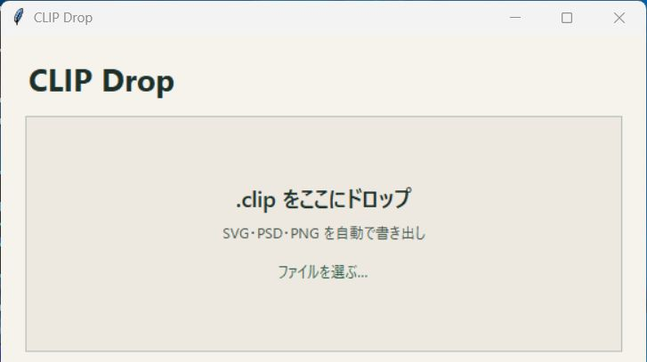
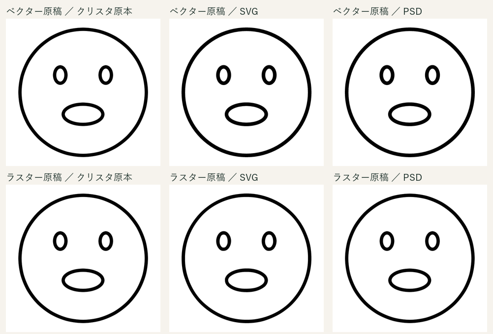

# CLIP Drop · Beta / 習作・ベータ版

Drop a .clip file on Windows to extract editable SVG paths from its stored vector strokes. CLIP Drop also traces raster layers into outline paths, and saves a layered PSD and a reference PNG in the same conversion. / クリスタの原稿（.clip）をドロップすると、ベクターレイヤーに保存された線を編集できるSVGパスとして取り出せます。ラスター層の輪郭もSVGに加え、レイヤー付きPSDと照合用PNGを同時に保存します。

  
  
  

[Watch a conversion / 実際の変換を見る](https://youtu.be/R_xONDHl3Jo) · [Download the three test projects / 検証原稿３点を入手](https://github.com/FURUYAN1234/clip-drop/releases/download/v0.1.0/CLIP-Drop-v0.1.0-samples.zip)

**Experimental beta.** This may help when you receive a .clip file on a Windows computer without Clip Studio Paint. Converter tests cover three line-art samples. / **習作・ベータ版です。** クリスタのないWindows PCで .clip を受け取ったとき、中身の確認や別アプリでの作業に使えるかもしれません。変換は線画３原稿で検証しました。

[v0.1.1 release / v0.1.1 公開版](https://github.com/FURUYAN1234/clip-drop/releases/tag/v0.1.1) · [Git tags / タグ一覧](https://github.com/FURUYAN1234/clip-drop/tags)

## Get started / 使い方

1. Download and extract the [Windows x64 release ZIP](https://github.com/FURUYAN1234/clip-drop/releases/download/v0.1.1/CLIP-Drop-v0.1.1-win-x64.zip). / [Windows x64用配布ZIP](https://github.com/FURUYAN1234/clip-drop/releases/download/v0.1.1/CLIP-Drop-v0.1.1-win-x64.zip)をダウンロードして、すべて展開します。
2. Run **CLIP Drop.exe** and drop one or more .clip files in the window. You can also use the file picker. / **CLIP Drop.exe** を起動し、.clipを枠へドロップします。ファイル選択にも対応しています。
3. Open the result folder next to the original. The app adds a number when the output name already exists. / 元原稿の隣にできる結果フォルダーを開きます。同名の結果がある場合は連番を付けます。

The included PDF opens from **マニュアル取得** in the app. The ZIP also includes the three test projects in its samples folder. / アプリの「マニュアル取得」から同梱PDFを開けます。配布ZIPのsamplesフォルダーには検証原稿３点を収めています。

The converter runs locally. It reads your source project and puts the exported files in a separate folder. / 変換はローカルで行います。原稿を読み取り、書き出しは別フォルダーに保存します。

The original drop-to-convert screen. In v0.1.1, the manual button is in the upper right. / 初版のドロップ画面です。v0.1.1では右上から操作マニュアルを開けます。

## Output / 出力

| File / 形式 | What you get / 内容 |
| --- | --- |
| SVG | Centerline paths from CLIP vector strokes and outline paths traced from raster layers. / ベクター層から作る中心線と、ラスター層からトレースする輪郭パス。 |
| PSD | Separate pixel layers for paper and artwork, with layer names, visibility and supported groups. Vector strokes are redrawn as pixels. / 用紙と絵を別々の画像レイヤーにし、レイヤー名・表示状態・対応するグループを引き継ぎます。ベクター線はピクセルとして描画します。 |
| PNG | The full-sized composite stored by Clip Studio Paint when available. / クリスタが保存した原寸合成画像があれば、その画素を使用します。 |
| TXT | Layer processing, fallbacks and approximation warnings. / 層ごとの処理と、代替処理・近似の記録。 |

## Conversion / 変換の仕組み

Technical papers in Google Docs / 日英技術論文

[日本語](https://docs.google.com/document/d/1eLC6hea-XPE8cK4vGVkaEVGPsWmY5HNjGVvHz6ArfVs/edit) · [English](https://docs.google.com/document/d/1RPXuJuqT8KXVtLmCRAsfeOj8eGOYv85a47nrpN44DEM/edit)

A cubic segment uses start and end positions $P_0,P_1$ and control points $C_0,C_1$. Stored cubic controls are used when available. For Clip Studio spline records the tangents are approximated from neighboring positions. / ３次ベジェ区間は端点 $P_0,P_1$ と制御点 $C_0,C_1$ で表します。３次ベジェレコードにある制御点はその座標を使い、クリスタのスプラインでは前後の点から接線を近似します。

$$
B(t)=(1-t)^3P_0+3(1-t)^2tC_0+3(1-t)t^2C_1+t^3P_1,\quad 0\le t\le1
$$

For a stroke with a stored radius $r$ and per-point width factors $w_i$, the prototype exports one SVG stroke width $W=2r\,\sum_i w_i/n$. Pressure-shaped width and brush texture can look different. / 保存された半径を $r$、各点の幅係数を $w_i$ とし、SVGの線幅を $W=2r\,\sum_i w_i/n$ とします。可変線幅やブラシの質感には差が出ます。

For raster layers whose alpha spans 0–255, tracing uses the binary silhouette $M(x,y)=\mathbf{1}[\alpha(x,y)\ge128]$. VTracer fits closed vector paths to the pixel boundaries and color regions. / 透明度が0〜255のラスター層では $M(x,y)=\mathbf{1}[\alpha(x,y)\ge128]$ の輪郭を使います。VTracerでピクセルの境界と色の領域を閉じたパスに近似します。

## Verification / 検証

These are results for three 1,600 × 1,200 CLIP files authored in CLIP STUDIO PAINT EX 4.1.4. The pair has the same artwork. The mixed file adds vector shapes over the raster drawing. / クリスタEX 4.1.4で作った1,600 × 1,200原稿３件の結果です。ベクター版とラスター版は同じ絵で、混在版にはベクターの図形を追加しました。

We rendered the SVG at the original dimensions. Ink pixels were defined as grayscale values below 128. For input ink set $A$ and output ink set $B$, the overlap is $|A\cap B|/|A\cup B|$. / SVGを原寸に描画し、グレースケール値128未満を線として、入力の領域 $A$ と出力の領域 $B$ の重なり $|A\cap B|/|A\cup B|$ を測りました。

| Sample / 原稿 | SVG ink IoU / 線の重なり | PNG composite mismatch / 異なる画素 |
| --- | ---: | ---: |
| Vector / ベクター | 92.2% | 0 |
| Raster / ラスター | 94.5% | 0 |
| Mixed / 混在 | 94.1% | 0 |

Photoshop 2026 opened the PSD exported from the vector sample with separate paper and artwork layers. CLIP STUDIO PAINT displayed editable points for both routes in the re-imported mixed SVG. / ベクター原稿のPSDをPhotoshop 2026で開き、用紙と線画を別レイヤーで確認しました。混在SVGをクリスタに読み戻し、両経路で制御点を選択できました。

In the mixed sample the PSD retained the paper, raster line art and rendered vector art as separate pixel layers. The empty source layer was omitted. / 混在原稿では元の用紙、ラスター線画、ベクター線画がPSDの別画像レイヤーとして残り、空レイヤー１枚は省かれました。

## Limits / 制約

This first release focuses on still artwork within 24 million pixels and 250 layers. CLIP-specific brush texture, live effects, masks, text, frame borders, and animation have limited interchange. / 初版は2,400万画素・250レイヤー以内の静止画が対象です。クリスタ固有のブラシ、効果、マスク、テキスト、コマ枠、アニメーションの編集互換には制限があります。

Illustrator can open the SVG. You can save as AI in Illustrator after opening the SVG. This version exports SVG, PSD and PNG. / SVGをIllustratorで開いたあと、Illustratorから .ai として保存できます。この版はSVG・PSD・PNGを書き出します。

## How CLIP Drop handles files and how that relates to the Celsys EULA / CLIPファイルの扱いとセルシスの使用許諾契約

**What v0.1.1 does.** CLIP Drop is an unofficial Windows tool. It reads the saved `.clip` file on the user's computer, leaves the original intact, and creates SVG, PSD, PNG and a conversion report in a separate folder. The conversion runs entirely on the user's computer, independently of the Celsys application, libraries and license authentication. / **v0.1.1の動作。** CLIP Dropは非公式のWindows用ツールです。PC上の `.clip` を読み取り、原稿をそのまま残して、SVG・PSD・PNGと変換レポートを別フォルダーに保存します。変換はユーザーのPC内で完結し、セルシスのアプリ本体・ライブラリ・ライセンス認証から独立しています。 [Conversion code / 変換処理](https://github.com/FURUYAN1234/clip-drop/blob/v0.1.1/conversion.py) · [Vector reader / ベクター線の読み取り](https://github.com/FURUYAN1234/clip-drop/blob/v0.1.1/clip_vectors.py)

**Third-party libraries in v0.1.1.** CLIP Drop uses clipparse 0.2.0 to read layers and pixels from saved `.clip` files. The clipparse maintainers describe their format analysis as based on saved files. CLIP Drop uses the library's read API and creates a separate PSD with psdparse 0.13.0. / **v0.1.1で使う第三者ライブラリ。** 保存済みの `.clip` からレイヤーと画素を読む処理にclipparse 0.2.0を使います。clipparseの作者は、実際の保存ファイルを調べて形式を解析したと説明しています。CLIP Dropが呼ぶのは読み取り用のAPIで、PSDはpsdparse 0.13.0を使って別ファイルとして作成します。 [clipparse 0.2.0](https://pypi.org/project/clipparse/0.2.0/) · [psdparse 0.13.0](https://pypi.org/project/psdparse/0.13.0/) · [Conversion code / 変換コード](https://github.com/FURUYAN1234/clip-drop/blob/v0.1.1/conversion.py)

**Vector stroke reader.** CLIP Drop's Python reader uses the public clipfile-rs documentation to interpret the saved stroke data. The Windows ZIP ships the Python implementation. clipfile-rs serves as a reference. / **ベクター線の読み取り。** 保存されたペンの軌跡や制御点を読む処理は、clipfile-rsの公開資料を参照し、CLIP Drop側でPythonに実装しています。Windows版ZIPに入っているのは、このPython実装です。 [clipfile-rs](https://github.com/Aodaruma/clipfile-rs) · [Vector reader / ベクター線の読み取りコード](https://github.com/FURUYAN1234/clip-drop/blob/v0.1.1/clip_vectors.py)

**What the MIT license covers.** The clipparse and psdparse authors grant permission to use and redistribute their software under the MIT license, including its requirement to preserve the copyright and permission notices. The Windows ZIP includes both libraries' notices. Whether Celsys's product agreement applies to a particular use, and what rights apply to the artwork and its assets, are separate questions. / **MITライセンスの範囲。** clipparseとpsdparseの作者は、著作権表示と許諾文の保持を条件に、それぞれのライブラリの利用・再配布をMITライセンスで許諾しています。Windows版ZIPには両方の著作権表示と許諾文を同梱しています。セルシスの製品使用許諾契約の適用や、原稿・素材の利用条件は別に確認が必要です。 [MIT license / MITライセンス原文](https://opensource.org/license/mit)

**What the published EULA says.** Section 1(1) defines the Product to include CLIP STUDIO PAINT, CLIP STUDIO, and materials, samples, documentation and updates supplied with the software or by Celsys as described there. Section 5(4) prohibits modifying included programs and analyzing the Product by methods such as reverse engineering. Sections 5(5) and 5(10) address providing third parties with the Product or its functions over a network and disabling technical restrictions on the Product. We found no provision in the published text that expressly prohibits reading a user-created project file and converting it locally as described above. This is our reading of the published text and implementation as of November 27, 2026. Celsys's position on this tool has not been verified. / **公開契約の記載。** 第1条(1)の「本製品」にはCLIP STUDIO PAINTとCLIP STUDIOのほか、同条に定める付属素材、サンプル、資料、更新データなども含まれます。第5条(4)は、本製品に含まれるプログラムの改変や、リバースエンジニアリングなどによる本製品の解析を禁止しています。第5条(5)は製品やその機能のネットワーク経由での第三者提供、第5条(10)は製品の技術的な制限の解除などに関する条項です。ユーザーが作成した原稿を読み取り、PC内で別形式に変換する上記の処理を明示的に禁じる規定は確認できませんでした。2026年11月27日時点の公開契約と実装を照合した見解で、CLIP Dropに対するセルシスの個別見解は未確認です。 [Celsys EULA / セルシス製品使用許諾契約書](https://www.celsys.com/information/csp/)

**Copyright and artwork permissions.** Article 10(3) of Japan's Copyright Act excludes programming languages, conventions governing their use and algorithms from the scope of a program's copyright protection. It does not resolve how a particular file format or license agreement should be treated. Article 30-4 can apply to the use of a program for investigation and analysis, subject to the statutory conditions. Contract compliance is a separate question. For artwork containing Celsys-provided materials, EULA section 12(2) restricts distributing the materials separately or distributing artwork in a form from which the materials can clearly be extracted. Before sharing layered output, check the applicable permissions for the artwork and any assets it contains. / **著作権法と原稿内の素材。** 著作権法第10条第3項は、プログラム言語、その用法に関する規約、解法をプログラムの著作権保護の範囲から除いています。個別のファイル形式や使用許諾契約の扱いは、この条項だけでは判断できません。第30条の4は、法定の条件を満たす場合にプログラムの調査・解析目的の利用にも適用され得ます。使用許諾契約への適合は別に判断する必要があります。また、契約第12条第2項は、セルシスが提供する「本素材」を分離して配布することや、作品から明らかに抽出できる状態で作品を配布することなどを制限しています。レイヤー付きの出力を共有する前に、原稿や素材に適用される利用条件を確認してください。 [Article 10 / 著作権法第10条](https://laws.e-gov.go.jp/law/345AC0000000048#Mp-At_10) · [Article 30-4 / 著作権法第30条の4](https://laws.e-gov.go.jp/law/345AC0000000048#Mp-At_30_4) · [Agency for Cultural Affairs / 文化庁の解説](https://www.bunka.go.jp/seisaku/chosakuken/hokaisei/h30_hokaisei/)

**Removal requests.** If Celsys submits a formal removal request, we will verify its scope and reasons and suspend public access to the affected content. / **削除要請への対応。** セルシスから正式な削除要請を受けた場合は、対象と理由を確認のうえ、該当する内容の公開を停止します。

## Credits / 参照

The CLIP vector layout follows the documented [clipfile-rs](https://github.com/Aodaruma/clipfile-rs) work. Layers and PSD output use [clipparse](https://github.com/wamsoft/clipparse) and [psdparse](https://github.com/wamsoft/psdparse). / CLIPのベクター形式はclipfile-rsの公開資料を参照し、画素読込とPSD出力にclipparseとpsdparseを使っています。

## Related apps and workflows / 関連アプリ・ワークフロー

| Name / 名称 | Source / ソース | Article / 紹介記事 |
| --- | --- | --- |
| Super FURU AI 4-koma System | [GitHub](https://github.com/FURUYAN1234/nano-banana-pro) | [note](https://note.com/happy_duck780/n/ndf063558c1f5) |
| AI Story Maker | [GitHub](https://github.com/FURUYAN1234/story-maker) | [note](https://note.com/happy_duck780/n/nd3d972922868) |
| AI Character Sheet Maker | [GitHub](https://github.com/FURUYAN1234/character-sheet-maker) | [note](https://note.com/happy_duck780/n/neccbebd7d957) |
| AI漫画翻訳ツール | [GitHub](https://github.com/FURUYAN1234/comic-translation) | [note](https://note.com/happy_duck780/n/ne462dfc55ec8) |
| PanoForge | [GitHub](https://github.com/FURUYAN1234/panoforge) | [note](https://note.com/happy_duck780/n/nb53b121fef88) |
| AI Voice Comic Maker | [GitHub](https://github.com/FURUYAN1234/ai-voice-comic-maker) | [note](https://note.com/happy_duck780/n/ndc6533c1512f) |
| 物語バズメーカー | [GitHub](https://github.com/FURUYAN1234/viral-radar) | [note](https://note.com/happy_duck780/n/ncc593101d77f) |
| ナレーション動画メーカー | [GitHub](https://github.com/FURUYAN1234/gemini-narration-studio) | [note](https://note.com/happy_duck780/n/n97d49c1c98b1) |
| AI Image Bridge | [GitHub](https://github.com/FURUYAN1234/ai-image-bridge) | [note](https://note.com/happy_duck780/n/n6747a089fce7) |
| AIトレーサー なぞり君 | [GitHub](https://github.com/FURUYAN1234/ai-tracer-nazori-kun) | [note](https://note.com/happy_duck780/n/n75301de9493a) |
| MiniMax H3 Video | [GitHub](https://github.com/FURUYAN1234/comfyui-h3-workflows) | [note](https://note.com/happy_duck780/n/n15e732b3147b) |
| MiniMax H3 MV | [GitHub](https://github.com/FURUYAN1234/comfyui-h3-workflows) | [note](https://note.com/happy_duck780/n/ne8a84cb6db37) |
| KomaOrbit | [GitHub](https://github.com/FURUYAN1234/comfyui-h3-workflows) | [note](https://note.com/happy_duck780/n/n3f68482d5edd) |
| 長尺動画AnimeSharpアップスケーラー | [GitHub](https://github.com/FURUYAN1234/comfyui-long-video-upscaler) | [note](https://note.com/happy_duck780/n/n0f190160e307) |
| 日本語おまかせ作曲 | [GitHub](https://github.com/FURUYAN1234/ComfyUI-YuE2-Japanese) | [note](https://note.com/happy_duck780/n/n57df44cf7fd2) |
| 日本語おまかせナレーション | [GitHub](https://github.com/FURUYAN1234/ComfyUI-Local-Narration-Japanese) | [note](https://note.com/happy_duck780/n/nda7ed302d544) |
| MangaScreen JP | [GitHub](https://github.com/FURUYAN1234/ComfyUI-MangaScreen-JP) | [note](https://note.com/happy_duck780/n/n5c89a250fb82) |
| Local Handoff MCP | [GitHub](https://github.com/FURUYAN1234/local-handoff-mcp) | [note](https://note.com/happy_duck780/n/n806c7bc6de94) |
| Codex Usage / Codex 残量 | [GitHub](https://github.com/FURUYAN1234/codex-usage-overlay) | [note](https://note.com/happy_duck780/n/n98e53f17d74a) |

[Suite overview / アプリ・ワークフロー総合案内](https://note.com/happy_duck780/n/nbdf826604ce7)

[Three .clip samples / 検証用原稿３件ZIP](https://github.com/FURUYAN1234/clip-drop/releases/download/v0.1.0/CLIP-Drop-v0.1.0-samples.zip)
